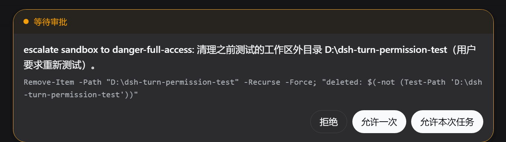

# dsh-turn-approval · 任务级授权

中文 | [English](README.en.md)

有些高风险操作值得你亲自点头，但同一个任务里，不该让你为同一件事反复点头。

`dsh-turn-approval` 为 DeepSeek Harness（DSH）Web 审批卡片增加 **「允许本次任务」**：当 Agent 请求 `danger-full-access` 时，你可以只授权当前任务余下时间内的同类升级。任务结束后，授权自动消失。



## 它做什么

默认的 DSH 权限保持 `workspace-write + ask`，不会被本插件改成全局高权限。

当 Agent 需要工作区外的高权限操作时，审批卡片会显示：

```text
[拒绝] [允许一次] [允许本次任务]
```

- **拒绝**：拒绝当前操作。
- **允许一次**：只放行当前操作。
- **允许本次任务**：在当前 turn 内，后续同类 `danger-full-access` 请求自动放行；`turn/end` 后立即失效。

## 安装

### 从 GitHub 安装

建议固定到一个 commit SHA，确保日后仓库更新不会静默改变本机运行的代码：

```sh
dsh plugin --profile web add github:arrow949/dsh-turn-approval#<commit-sha>
```

插件为已提交构建产物的纯 ESM JavaScript；从 GitHub 安装时不需要 `prepare` 脚本或 pnpm `allowBuilds` 权限。

### 从本地目录安装

```sh
dsh plugin --profile web add ./dsh-turn-approval
```

安装后重启 DSH Web，并在浏览器中硬刷新（`Ctrl+Shift+R`）。出现第三个按钮即表示插件已加载。

## 使用

1. 正常使用 DSH，平时仍是 `workspace-write + ask`。
2. 当 Agent 请求 `danger-full-access` 时，阅读审批原因与命令。
3. 若你愿意在**当前任务内**继续授予同类高权限，点击「允许本次任务」。
4. 当前任务结束后，下一条消息会重新逐项询问。

## 验证与卸载

查看当前 profile 是否挂载了插件层：

```sh
dsh --profile web --dump-config
```

卸载：

```sh
dsh plugin --profile web remove dsh-turn-approval
```

卸载后，Node half 与 client half 会一并移除，审批卡片自动回到 DSH 官方默认的两个按钮；不会遗留对官方文件的修改。

## 安全边界

- **仅内存**：授权不写入磁盘；DSH 进程重启、插件卸载或 session/agent 被释放后失效（fail-closed）。
- **任务绑定**：授权绑定 `session + turn`，不会把整个 session 切换为 full access。
- **不串权限**：一个 session 的授权不影响另一个 session；子代理使用独立 session，不继承授权。
- **类型隔离**：只自动放行明确匹配的 `danger-full-access` 升级；`workspace-write` 和其他审批仍逐一询问。
- **用户触发**：grant 只能由审批卡片按钮建立，模型没有自行开启任务授权的入口。
- **可审计**：自动放行仍保留完整的审批事件记录。

点击「允许本次任务」后，插件会先向宿主建立任务授权。若端点返回非 2xx 或网络请求失败，卡片会明确提示失败并保持可重试；它不会假装授权已建立，也不会静默降级为“允许一次”。

## 实现与兼容性

本包是官方定义的 DSH bundle：`package.json` 声明 `dsh.bundle.patch`，`cordis.patch.yml` 将插件加入 profile。client half 通过官方 `conversation.composer` chain 槽位，以更高优先级渲染审批卡片；**不修改任何 DSH 官方 bundle 文件**，卸载即还原。

当前外观复用官方 ApprovalPanel 的内部 CSS 类名。若未来 DSH 改动该组件结构或 CSS module 类名，本插件可能需要发布兼容更新；这不是修改官方文件。

仅支持 DSH Web：headless profile 没有 UI 入口，任务授权端点不会注册。

## 给 AI 助手的安装说明

在用户明确要求安装本插件后，执行：

```sh
dsh plugin --profile web add github:arrow949/dsh-turn-approval#<commit-sha>
dsh --profile web --dump-config
```

然后提示用户重启 DSH Web 并硬刷新浏览器。不要修改 DSH 官方 bundle 文件。卸载命令为：

```sh
dsh plugin --profile web remove dsh-turn-approval
```

## 开发与测试

```sh
pnpm install
pnpm test
```

当前测试覆盖 turn 与 session 隔离、类型隔离、端点防伪造、重启 fail-closed，以及 Cordis 集成链路。

## License

MIT
